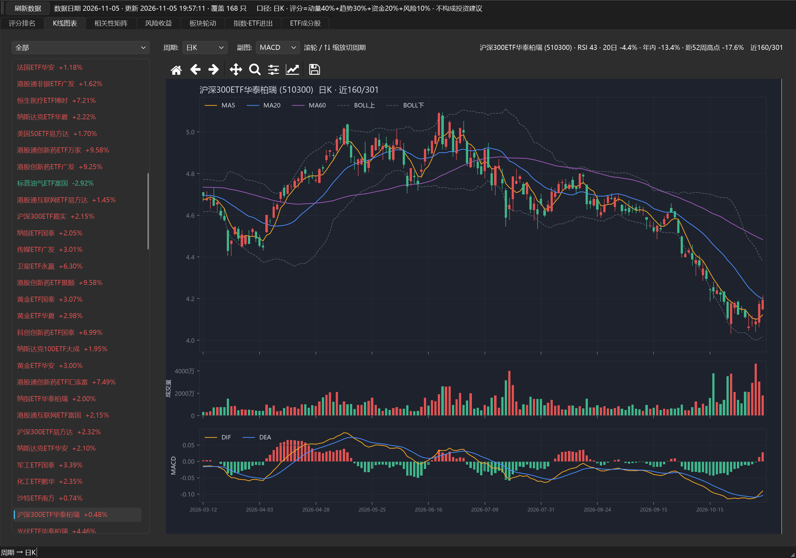

# ETF 指数罗盘 · IndexCompass

[](https://github.com/Syakukou/ETFindex-compass/actions/workflows/build.yml)
[](https://github.com/Syakukou/ETFindex-compass/releases)
[](https://github.com/Syakukou/ETFindex-compass/releases)
[](LICENSE)

A 股场内 ETF 的监测工具。覆盖 168 只 ETF 的评分、分时与多周期 K 线、相关性、风险收益、板块轮动、资金流与持仓穿透。PySide6 + matplotlib 单机运行，数据由本机向公开行情接口实时请求，不上传任何本地数据。

> **先读这段再决定要不要用**
>
> 本项目是数据分析工具，**不是投资建议系统**。作者不具备证券投资咨询业务资格，不推荐任何标的，不提供买卖点、仓位建议或择时信号。界面上的评分、排序、资金流、持仓穿透，全部是对已发生数据的重新组织，不预测未来。
>
> 数据来自第三方公开接口，存在延迟、缺失、口径变动和错误，**不可用于实盘交易决策**。任何依据本工具作出的决策及后果由使用者自行承担。



七个页签：综合评分、行情走势、相关性、风险收益、板块轮动、指数资金流、持仓穿透。

## 功能

| 页签 | 内容 |
|---|---|
| 综合评分 | 四因子打分（趋势 / 动量 / 波动 / 资金），全池排序 |
| 行情走势 | 8 种周期切换：分时、5/15/30/60 分钟、日K、周K、月K。除了下拉框，鼠标滚轮或 ↑↓ 就能连续缩放切周期（同一周期内先改看的根数，看到 30 根还不够细就跨到下一档，反过来缩到全图再缩就进更粗的周期），跨档到更细的周期时先给 120 根当过渡。分时含价格线、均价线、昨收基准、右侧涨跌幅刻度，成交量按每分钟涨跌染色；K 线含 MA5/20/60、BOLL、成交量与 MACD/RSI/KDJ 副图。点击图内任意位置弹出该时刻的价格、涨跌幅、均价、量能（K 线上是开高低收） |
| 相关性 | 全池两两相关，默认全部配对（168 只里 155 只有足够 K 线，11935 对全部列出），可按名称筛选、按列排序、点格子看该对走势，点完左侧配对表自动定位到同一对 |
| 风险收益 | 区间收益 × 区间波动散点，默认全部标的；点圆点选中的行会在左侧表里滚到中间，点左侧表任一行散点图立刻用十字线标出该点，双向联动 |
| 板块轮动 | 分类资金进出横向柱图与文字行双向对应，点柱或点行都能跳转 |
| 指数资金流 | 宽基指数 × ETF 资金流 × 股指期货基差持仓 × 期权 PCR 隐波，四维对账。上方是蜡烛图（开高低收 + MA5/MA20），下方是 5 日资金动能柱，指数与基差分别走右轴。滚轮或 ↑↓ 同样缩放切周期：日K → 周K → 月K，缩到本周期五成以上根数就跨到下一档；点图任意位置出当天的开高低收、涨跌与资金动能。资金动能只有日频，所以这一页最细就是日K |
| 持仓穿透 | 单只 ETF 的季度持仓明细，18 列：权重、环比、累计、持股、市值、行情、PE、流通市值、北向、主力资金、机构类型、所属行业；可切换库里的任一报告期，点某只股票反查哪些 ETF 持有它 |

## 安装

需要 Python 3.10 以上。

```bash
git clone https://github.com/Syakukou/ETFindex-compass.git
cd ETFindex-compass
python -m venv .venv
# Windows
.venv\Scripts\activate
# macOS / Linux
source .venv/bin/activate

pip install -r requirements.txt
```

不装 Python 的话，直接下 Releases 里对应自己系统的包：

| 系统 | 文件 | 用法 |
|---|---|---|
| Windows 10/11 | `IndexCompass-windows.zip` | 解压后双击 `IndexCompass.exe` |
| macOS Apple 芯片（M1 及以后） | `IndexCompass-macos-arm64.zip` | 解压得到 `IndexCompass.app`，拖进「应用程序」 |
| macOS Intel（2020 年前机型） | `IndexCompass-macos-x86_64.zip` | 同上 |

首次启动需要联网抓数据。

macOS 包没有做苹果开发者签名（需要付费证书），首次双击会被系统拦下。右键点 `IndexCompass.app` 选「打开」，在弹窗里再点一次「打开」即可，之后双击就正常了。也可以在终端跑一次 `xattr -dr com.apple.quarantine /Applications/IndexCompass.app`。

macOS 的数据放在 `~/Library/Application Support/IndexCompass/`，不在 app 包里面。这样可以随时覆盖安装或删掉 app 而不丢库，卸载时把这个目录一起删掉就干净了。

## 运行

首次运行会自动建库并抓取 ETF 列表与行情，需要几十秒到几分钟。全池持仓明细首次抓取视网络情况可能更久。

```bash
python etf_pub.py      # 发布版主题
python etf_pro.py      # 自用版主题
```

数据库 `etf_tracker.db` 生成在当前目录，不进版本库。删掉重跑即可全量重建。

其他入口：

```bash
python etf_app.py        # 网页版仪表盘
python etf_desktop.py    # Tkinter 轻量版
```

## 数据口径

这部分重要，用之前先看。所有页签的数字都建立在下面这些前提上。

**行情与资金流。** 取自第三方公开行情接口，按其对外展示口径原样呈现。主力资金、涨跌幅、换手率等字段均为接口方算法，本项目不做二次加工，也不对算法本身是否合理作判断。

**数据时效。** 日线类数据在收盘后趋于稳定，盘中取到的是未完成数据，当日涨跌幅、资金流会随盘面变动。份额、规模类数据更新频率低于行情，不同字段的时间戳并不一致。界面上不逐字段标注时间，需要精确数值请回原始来源核对。

**分时与分钟K。** 分时取的是 1 分钟线，不是逐笔成交：每个点是那一分钟的最后成交价，均价为当日累计成交均价（成交额除以成交量）。5/15/30/60 分钟线取同一接口的分钟聚合。周K、月K 由日K 按 ISO 周与自然月合成，取首日开盘、末日收盘、区间最高最低、量额求和，不是独立数据源，所以补齐历史只能靠日K 的保留长度（约两年）。分钟数据只在盘中增量更新，收盘后保留当日走势；切到分时页且停留时每分钟自动重取一次，切走就停。

**指数资金流的口径。** 指数日线取近 420 个交易日（约一年半），资金动能由本地日线按 5 日 CLV 加权算出来，覆盖约 256 个交易日，所以把日K 缩放很长时，图上前段只有 K 线没有资金柱——那是本地库没有那段记录，不是零流入，图上会标出资金记录从哪天开始。周K、月K 的 K 线在本地用 ISO 周与自然月合成；资金动能取该周（月）末日的 5 日累计值，不做加总，否则滚动窗口会重复计算。

**成分股持仓。** 基金定期报告。A 股基金一季报、三季报只披露前十大重仓，半年报、年报才披露全部持仓。所以某些 ETF 明细只有 10 到 15 行是披露规则决定的，不是抓取失败。想看全量，得等中报或年报。报告期到实际可得之间有滞后，界面会标出当前用的是哪一期。

**北向持股。** 2024 年 8 月起，交易所停止逐日披露个股北向持股明细。本项目退而使用十大流通股东中的香港中央结算持股，占比按持股数除以当前流通股本估算。未进入前十大流通股东的标的显示为「—」，这不等于零持仓。**这是代理指标，不是真实北向数据。**

**机构持仓。** 险资、券商、QFII、社保等来自基金半年报与年报的持有人结构，以及十大流通股东明细。报告期滞后，界面上会标出当前用的是哪一期。

**相关性。** 基于日收益率，窗口可选。样本不足的新 ETF 不参与配对。

**缺失值。** 界面上「—」表示该字段未取到或该期未披露，不代表数值为零。字段为空、行数偏少、整列空白，先怀疑披露规则和数据源，再怀疑程序。

## 成分股：为什么有的 ETF 只有 15 只

季报（一季、三季）只披露前十大重仓，中报、年报才是全部持仓。所以 588220 科创 100ETF 在 2026Q3 只有 15 行，切到 2026Q2 就是 100 只。

页面上「季度」下拉会标出每一期的行数，选哪期看哪期，库里已披露的季度都存着，不重抓。

池里 168 只 ETF 的实际构成：134 只有股票持仓明细，13 只是 2026 年 10 月底刚成立、尚未上市的主动管理 ETF，21 只是货币、黄金白银、商品期货、跨境类，季报只披露资产构成，本来就没有股票明细。这三类加起来正好 168，没有「缺失」可补，所以界面上不设批量补全按钮。想让某只重抓，选中它点「重取该只」。

右侧表格点某只股票，左侧列表中持有它的 ETF 会标成橙底；再点左侧任何一只 ETF，橙底立即清除、改为选中该只；双击右侧股票行跳到仓位最重的那只。橙底扫的是库内全部披露期，不是当前看的那一期，所以数量常常多于本季表格里的家数，提示行会写明其中多少只来自中报、年报全量。鼠标停在任何一只橙底上，可以看到它是在哪一期持有这只票、占净值多少。

橙底家数少不代表界面漏显示。池内 134 只 ETF 的披露持仓一共覆盖 3063 只股票，其中 1197 只只被 1 只 ETF 持有，533 只被 2 只持有，190 只被 3 只持有。ETF 本身是行业或主题产品，覆盖面窄，加上季报只披露前十大，中小市值股票出现在两三家 ETF 的披露里是常态。

## 常见问题

**打不开或闪退。** 先确认解压完整，不要直接在压缩包里运行 exe。Windows 可能提示来源不明，属正常现象，本项目未做代码签名。macOS 提示「无法验证开发者」也是同一原因，右键选「打开」放行一次就行。

**首次启动卡住。** 在抓全池数据，视网络情况需要几分钟。断网状态下只能看已缓存的库。

**数字和行情软件对不上。** 优先怀疑时间差和接口口径。资金流、份额类字段各家算法不同，不保证一致。

**某只 ETF 完全没有持仓明细。** 见上一节，货币、商品、跨境类本来就没有股票持仓。

## 反馈与提问

提之前先翻一眼上面「数据口径」和「常见问题」两节，一半的问题在那儿已经有答案，尤其是持仓只有十几行、数字和行情软件对不上这两类。

**技术问题走 Issues**：[新建 Issue](https://github.com/Syakukou/ETFindex-compass/issues/new/choose)。点进去有三个模板，按情况选：

| 模板 | 用在什么时候 | 必须带的信息 |
|---|---|---|
| 报错 / 闪退 / 拉不到数据 | 弹窗报错、进程直接退出、价格列全是「—」、标的只剩几只 | 版本号、系统、运行方式、现象描述、`refresh.log` 最后 20 行 |
| 数据不对 / 数字可疑 | 某只 ETF 的数值与公告或行情软件明显不符 | 代码、页签、数据日期、界面显示多少、你认为应该是多少、依据 |
| 功能建议 | 想要某个功能，或某处用起来别扭 | 使用场景、现在怎么绕过、期望的样子 |

版本号在**窗口标题最右边**，形如 `v1.0.5`，报错弹窗的第一行也带。`refresh.log` 在 Windows 上是 exe 同目录，macOS 上是 `~/Library/Application Support/IndexCompass/`。没有这两个信息，只能靠猜是哪一版出的问题，来回问答会拖很久。

**开放讨论走 Discussions**：[Discussions](https://github.com/Syakukou/ETFindex-compass/discussions)。放「这个指标该怎么解读」「这类 ETF 该不该进池子」「你平时怎么用它」这类没有标准答案的话题，以及自己改出来的用法。有明确报错或数据错误仍然走 Issues，那边能贴文件、能追踪状态。

**不适合公开贴的内容**：公众号「心镜不语悔不过」后台留言。装不上、看不懂界面这类问题在那儿问也行，只是没法贴日志和截图，排查效率低一些。

**先搜一下再提**：Issues 页面右上角的搜索框会连已关闭的一起搜，很多问题已经有人问过。

**明确不做的**：荐股、评级、目标价、买卖点、仓位建议；自动交易、券商接口对接、实盘下单；代抓数据或对外分发数据。这几类不用提，方向就不对。

**响应**：个人维护，不保证响应时效，也不承诺每条建议都实现。能复现的会修；属于数据口径而非程序错误的，会补进上面「数据口径」一节，不再单独回。

## 打包

```bash
pip install pyinstaller
pyinstaller IndexCompass.spec
```

产物在 `dist/IndexCompass/`（macOS 上还会多一层 `IndexCompass.app`）。onedir 模式下 `etf_tracker.db` 与 `etf_list.json` 需要放到 exe 同级目录，程序会自动读取；macOS 上这两样改放 `~/Library/Application Support/IndexCompass/`，程序自己建。

仓库配了 GitHub Actions（`.github/workflows/build.yml`）：推到 `v*` 标签会自动在 Windows 和 macOS 上打包、压缩并挂到 Release；也可以在 Actions 页面手动触发，只产出 artifact 不发版。PyInstaller 不能交叉编译，所以 macOS 包必须在 macOS 环境出，不能在 Windows 上代劳。

## 目录结构

```
etf_pro.py        主程序，PySide6 七页签终端
etf_app.py        SQLite 存储与行情刷新
etf_analytics.py  四因子评分、相关性、轮动、每日结论
etf_flow.py       ETF 资金流与 K 线
etf_minute.py     分时与分钟线、周月 K 聚合
etf_hold.py       成分股持仓（全部季度）
etf_inst.py       机构与北向持股
etf_index.py      指数、期货、期权数据
etf_meta.py       名称解析与跨境判断
etf_desktop.py    Tkinter 轻量版
brand.py          品牌与主题（自用 / 发布两套外观）
app_env.py        跨平台环境（数据目录、中文字体、应用标识）
etf_pub.py        发布版入口
etf_list.json     ETF 池配置
```

## 使用边界与免责

**不构成投资建议。** 本项目是数据整理工具，输出内容不含任何荐股、评级、目标价、买卖时机或仓位建议。作者不具备中国证券监督管理委员会认可的证券投资咨询业务资格，与本项目相关的任何内容均不构成《证券法》意义上的投资咨询。

**不保证数据正确。** 全部数据取自第三方公开接口与基金定期报告，可能延迟、缺失、重复、错位或因接口调整而中断。本项目不做数据校验承诺，也不对由此产生的判断偏差负责。需要用于严肃研究时，请以交易所、基金公司公告、定期报告原文为准。

**不预测。** 评分、排序、相关性、资金流均为历史数据的不同切面，不具备预测能力。任何回看有效的规律在未来都可能失效。

**风险自担。** 软件按 GNU GPL v3 许可「按原样」提供，不附带任何明示或暗示担保。使用或无法使用本软件造成的任何直接、间接损失，作者不承担责任。证券市场风险极高，决策后果由使用者自负。

**不再分发数据。** 本项目不附带、不内置、不打包任何行情数据库。所有数据由使用者本机在运行时向公开接口请求，仅存于本地。请勿将抓取结果对外分发或商用，那属于数据提供方的权利范围，与本项目许可无关。

**非官方。** 本项目与任何交易所、基金公司、数据服务商均无关联，未获其授权或背书。

**关于许可与收费。** 代码以 GNU GPL v3 开放。你可以使用、修改、分发，也可以对分发行为收费，但衍生作品必须同样以 GPL v3 开放源代码，并向接收者提供对应源码。换言之，允许收钱，不允许把代码闭起来收钱。许可覆盖的是代码，不覆盖数据；作者也不为任何衍生版本的准确性或合规性背书。

## 许可

代码以 [GNU General Public License v3.0](LICENSE) 发布，Copyright (C) 2026 Syakukou。

你可以自由运行、研究、修改和再分发本程序，也可以对分发收取费用，但需遵守 GPL v3：分发时必须一并提供完整源代码，且衍生作品同样以 GPL v3 授权。本仓库即为对应源码，分发打包产物时请注明对应的版本标签，例如 `v1.0.0`。

打包产物内含若干第三方开源组件，各自的许可与版权声明见 [THIRD_PARTY_LICENSES.txt](THIRD_PARTY_LICENSES.txt)。依赖清单见 `requirements.txt`。
